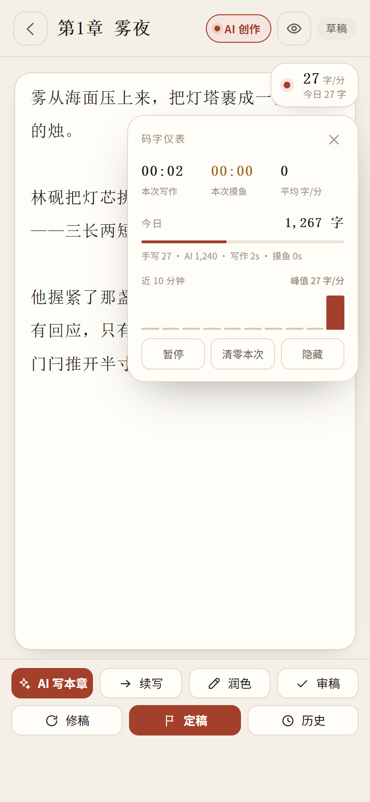

# 书童 Pagekin · 安卓版

[](LICENSE)
[](#)
[](#版本)

把 [EthanYoQ/AI-Novel-Writer](https://github.com/EthanYoQ/AI-Novel-Writer)（Electron + React 19 + SQLite + LanceDB 的桌面写作软件）重新实现成**手机原生 App**：不是网页套壳，是 Capacitor 8 打包的 Android 安装包，返回键、状态栏、字体渲染、离线存储全部按手机习惯重做。经原作者同意发布，遵循同样的 GPL-3.0 协议。

当前版本 **v1.8.2**（versionCode 11）· 1080×1920 竖屏优先 · 完全离线可用。

<p align="center">
  
  
  
  
</p>

---

## 为什么重写而不直接搬

上游是桌面架构：SQLite 存正文、LanceDB 做向量检索、Electron 主进程管文件。这套在手机上跑不动，也没有对应的运行环境。这里的替代方案：

| 上游 | 本项目 | 原因 |
| --- | --- | --- |
| SQLite（better-sqlite3 原生模块） | **IndexedDB** + 内存镜像 | Android WebView 无原生模块，IndexedDB 异步但够快 |
| LanceDB 向量检索 | **中文 2-gram BM25**（段落切块 620 字、重叠 90 字） | 端侧跑 embedding 太贵；BM25 在十万字级语料上召回够用 |
| Electron 主进程 + IPC | **纯前端单页 + Capacitor 桥** | 无 Node 运行时，所有逻辑落到浏览器侧 |
| React 19 组件树 | **原生 JS + 模板字符串渲染** | 冷启动从 ~2s 压到 ~300ms，包体从 120MB 降到 5.4MB |
| 桌面窗口布局 | **竖屏重排 + 底部安全区** | 单手可达、拇指热区、刘海避让 |

## 功能

### 双模式 AI 闸门
一个开关决定这台手机是「AI 帮你写」还是「AI 只帮你查」。

- **生成模式** —— 写本章、续写、拆章、润色、扩写全部可用。
- **辅助模式** —— 8 个生成入口被硬闸门（`genBlocked()`）拦下，只留审稿、查漏洞、纠错、拆书。适合"我想自己写，别替我落笔"。

闸门在状态层拦截，不是把按钮藏起来，绕过 UI 也调不出生成。

### 16 种审稿技能

| 分组 | 技能 |
| --- | --- |
| 审查 | 逻辑硬伤、人物崩坏、节奏拖沓、对话平淡、视角混乱、设定冲突、伏笔遗漏、情绪断点 |
| 纠错 | 错别字、标点误用、重复用词、病句 |
| 打磨 | 场景描写、金句提炼 |
| 章纲 | AI 拆章 |
| 创意 | 脑洞扩展 |

技能输出分三型：**issue-JSON**（可勾选采纳的问题清单）、**prose-Markdown**（成段建议）、**blueprint**（结构化章纲）。审查结果勾选后可一键 `refineFromReview` 自动复验，形成"审 → 改 → 复验"闭环。

### 章纲罗盘（悬浮窗）
写作时随时拉出来的本章作战面板：字数目标、本章目的、关键事件、结尾钩子、可勾选的节拍（`beats[{text,done}]`）、待埋伏笔、待收线索、张力五星、AI 拆章。收起后不占屏幕，展开时遮罩挂 `body` 层（`z-index: 40`，浮窗 41），不会挡住右侧操作抽屉。

### 码字仪表
和番茄钟相反的思路——**不打断你**。

- 8 秒无输入才判定为摸鱼，否则连续打字的停顿不算休息。
- 摸鱼计时、净码字时长、实时码字速度（字/分钟）分列。
- AI 生成的字数单独记，不混进你的手速。
- 悬浮 pill 可拖拽，位置存 `localStorage`；空闲 10 秒淡到 0.52 透明度，摸鱼超 3 分钟转琥珀色。
- 每日目标、今日汇总、`resetToday()`。

### 写作与编辑
- 逐段合并：AI 建议逐段采纳/拒绝，不是整篇覆盖。
- 词级 diff：改了什么，逐字标出来。
- 段落级编辑、章节行内菜单（重命名同步蓝图 / 复制正文 / 编辑蓝图 / 删除并先 `pushVersion`）。
- 版本快照：删除和重写前自动留档。

### 资料库（替代向量库）
导入 txt / md / epub，自动切块建索引。写本章时按**当前章蓝图**检索 top 4；续写时按**前文尾 500 字**检索 top 3；无命中回退到上一章结尾。可逐本启停、重命名、检索测试。

阈值用相对截断（最高分的 32%，下限 0.08）而不是绝对值——小语料下绝对阈值会把结果全过滤掉。

### 全书搜索
一个入口搜全部：作品、章节正文（带命中片段）、角色、线索、资料库。并入命令面板，不额外占一屏。

### 关系图谱与线索时间线
- 角色关系 SVG 环形图，点一个角色只显示与之相关的连线。
- 线索时间线：按"埋伏 → 推进 → 回收"三态铺在时间轴上，`moved === planted` 时不重复画点。

### 导出
分章 Markdown、TXT、JSON、EPUB 四种。EPUB 带目录和章节切分，可直接进阅读器。

### 外观与交互
字号、行距、字体、预览四种可调；明暗主题；命令面板（`⌘K` 式，手机上是顶栏入口）；数据体检（字数异常、空章、蓝图缺失、孤立角色一次性列出）。

### 返回键（Android 原生）
上游没有这个概念，这是移植时最容易翻车的地方。`MainActivity` 接管 `OnBackPressedDispatcher`，调用 `window.__wbBack()`，按优先级处理：

```
关弹层 → 退沉浸 → 收罗盘 → 收仪表 → 保存正文并返回上一页 → 书架提示「再按一次返回键退出」→ moveTaskToBack()
```

页面栈只有一个真相源（`State.stack`），`popstate` 按 `history.state.idx` 削栈，不会出现"返回到不存在的页面"。

## 与 PC 版的差异

**手机更好用的**

| | 说明 |
| --- | --- |
| 随身写 | 地铁上想到一句就能记，PC 做不到 |
| 码字仪表 | PC 版没有，摸鱼/手速可视化 |
| 单手操作 | 全部操作在拇指热区 |

**PC 版更强、这里有意不做的**

| | 原因 |
| --- | --- |
| 大屏改稿 | 结构性重写在 6 寸屏上体验必然差，不硬凑 |
| SKILL.md 文件导入 | 手机没有文件系统概念，改为内置 16 技能 |
| 云端备份 | 目前走 JSON 导入导出，避免把 API Key 托管到第三方 |
| Electron 网络代理 | WebView 无对应能力 |
| 编辑器内章节拆分 | 涉及章号平移，风险大于收益，暂缓 |

## 技术栈

- **前端**：原生 JavaScript（无框架）、CSS 变量主题、IndexedDB、Service Worker 离线缓存
- **原生**：Capacitor 8、Android SDK 36、Gradle 8
- **打包**：AGP + apksigner（v2 签名）
- **测试**：Playwright（复用本机 Edge）+ 自建 151 项端到端用例

## 目录

```
ai-novel-writer-mobile/    App 源码（唯一的实现来源）
├── js/
│   ├── app.js             路由、页面渲染、返回栈
│   ├── db.js              IndexedDB 封装
│   ├── prompts.js         提示词模板（可编辑）
│   ├── llm.js             模型调用
│   ├── skills.js          16 技能 + issue 解析
│   ├── compass.js         章纲罗盘
│   ├── hud.js             码字仪表
│   ├── materials.js       资料库 + BM25
│   ├── merge.js           逐段合并
│   ├── graph.js           关系图谱
│   ├── exporter.js        导出
│   └── epub.js            EPUB 生成
├── css/style.css
├── index.html
├── sw.js
└── build.js               → dist/site

shutong-android/           Capacitor 壳工程
└── android/               MainActivity 返回键接管在这里

demo-video/                介绍视频源（分镜页 + 时间轴 + 配乐合成）
e2e-tools/                 端到端测试
ui-shots/                  界面截图
```

## 构建

```bash
# 1. 前端
cd ai-novel-writer-mobile
node build.js                 # 产出 dist/site

# 2. 同步进安卓工程
cd ../shutong-android
rm -rf www/* && cp -r ../ai-novel-writer-mobile/dist/site/* www/
npx cap sync android

# 3. 打包
cd android
ANDROID_HOME=/path/to/android-sdk ./gradlew assembleRelease
```

签名需要自备 keystore，配置 `android/app/build.gradle` 的 `signingConfigs`。**仓库里不含任何 keystore 或签名口令。**

只在浏览器里跑（开发调试）：

```bash
cd ai-novel-writer-mobile
node build.js && cd dist/site && python -m http.server 4173
```

## 测试

```bash
cd e2e-tools
npm install
node smoke.js        # 19 项
node features2.js    # 13 项
node features3.js    # 18 项
node features4.js    # 7 项
node features5.js    # 17 项
node features6.js    # 28 项
node features7.js    # 14 项
node features8.js    # 19 项
```

合计 **151 项**，覆盖启动、路由、AI 闸门、技能输出解析、罗盘蓝图、仪表计时、BM25 召回、返回栈、导出格式、正文页抽屉与占屏比例。

## 版本

| 版本 | 内容 |
| --- | --- |
| v1.8.2 | 正文页操作收进右侧抽屉，正文框吃满整屏（占屏 90%）；修复旧 WebView 高度塌陷 |
| v1.8.1 | 正文框高度改为实算，修正 .gitignore/.gitattributes |
| v1.8 | 资料库（BM25）、全书搜索、章节行内操作、线索时间线、数据体检 |
| v1.7 | 安卓返回键接管、统一页面栈 |
| v1.6 | 16 技能库、章纲罗盘悬浮窗 |
| v1.5 | 双模式 AI 闸门、码字仪表 |
| v1.4 | 逐段合并、词级 diff、关系图谱、命令面板、外观设置、分章导出 |
| v1.0–1.3 | 书架、编辑器、Blueprint、角色、AI 生成、导入导出 |

## 来源与协议

本项目是 [EthanYoQ/AI-Novel-Writer](https://github.com/EthanYoQ/AI-Novel-Writer)（书童，作者：一醉桂花酒）的安卓移植版，**经原作者同意发布**，并按原作要求遵循**同样的开源协议 GPL-3.0**。

原作是面向长篇小说与网文连载的桌面写作软件，技术栈为 Electron + React 19 + SQLite + LanceDB。本项目并非把桌面端直接塞进手机，而是重新组织同一套工作流——书架、Blueprint 章纲、角色、审稿技能、资料检索、导出——全部按竖屏和单手操作重排。

因为平台限制，三处核心机制换成了不同实现（见上文对照表）：SQLite → IndexedDB、LanceDB 向量检索 → 中文 2-gram BM25、Electron 主进程 → 纯前端 + Capacitor 桥。界面结构与交互设计承袭原作思路，已获原作者授权。

### GPL-3.0 对你的实际含义

- 可以自由使用、修改、分发本软件，商用也可以；
- 如果修改后再发布（包括打包成安装包分发），**必须**同样以 GPL-3.0 公开你的完整源代码，保留原作者署名与本协议文本；
- 不提供任何担保。

作者与原项目的版权归原作者所有。介绍视频里的配乐由脚本合成，不含任何第三方版权音频。

## License

[GNU GENERAL PUBLIC LICENSE v3.0](LICENSE)

Copyright (C) 2026 Pagekin Mobile contributors

Based on [AI-Novel-Writer](https://github.com/EthanYoQ/AI-Novel-Writer) by 一醉桂花酒, licensed under GPL-3.0.
